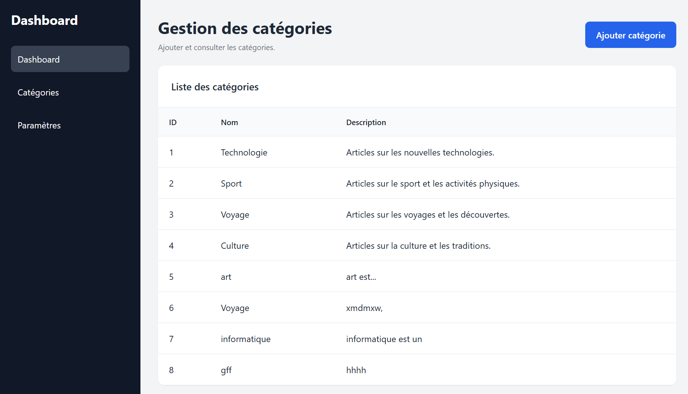
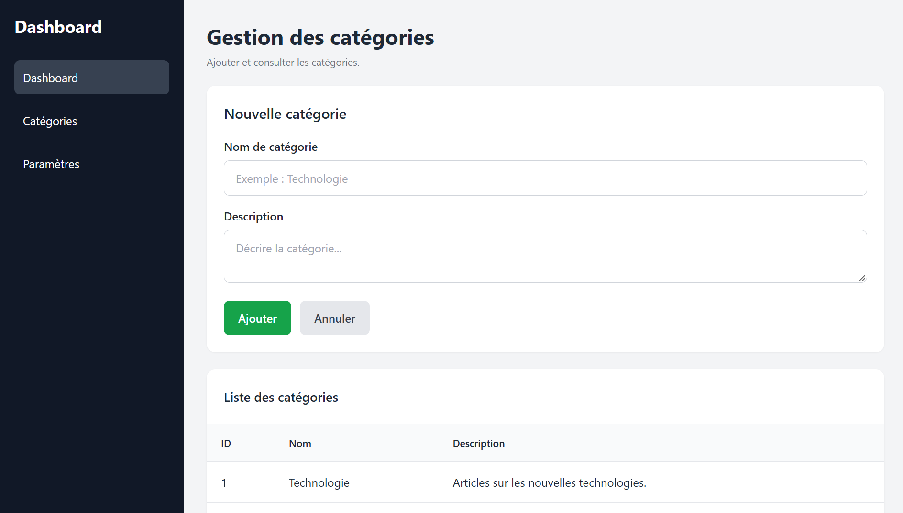

# Lab : Présentation du Projet – Gestion des Articles

## Introduction

### Plan de la présentation

Voici les différentes parties de notre présentation :
1. [1. Sujet du projet](#1-sujet-du-projet) : Découvrir le site web et les rôles.
2. [2. Objectif du projet](#2-objectif-du-projet) : Comprendre le but et les fonctionnalités.
3. [3. Structure des données](#3-structure-des-données-les-3-tables) : Voir les 3 tables (`Rédacteur`, `Catégorie`, `Article`).
4. [4. Ajouter des catégories et des articles](#4-ajouter-des-catégories-et-des-articles) : Découvrir les actions de l'administrateur.

## 1. Sujet du projet

Notre projet est un **blog de publication des articles**. C'est une application web qui permet de publier et de lire des articles.

Le projet a deux pages principales :

- **Accueil / Admin** : affiche les articles publiés.
- **Ajouter un article** : permet au rédacteur d'ajouter un nouvel article.

### Les rôles dans le projet

- **L'administrateur** : ajouter des catégories et les articles.
- **Le rédacteur** : écrit et publie des articles.

### Exemples de styles de texte

- Texte important : **Le blog permet de publier des articles.**
- Texte en italique : *Chaque article appartient à une catégorie.*
- Texte barré : ~~Ajouter une boutique en ligne~~.

Pour découvrir Markdown, voici un [Guide Markdown](https://www.markdownguide.org).

### Capture de la page d'accueil

Voici la page principale du blog :

> Le blog aide les rédacteurs à publier leurs articles.

---

## 2. Objectif du projet

Le but du projet est de créer un blog simple. Il permet d'afficher les articles et d'ajouter de nouveaux articles.

### Les objectifs principaux

1. Afficher les articles sur la page d'accueil.
2. Permettre au rédacteur d'ajouter un article.
3. Classer les articles par catégorie.
4. Permettre à l'administrateur de gérer les catégories.

### Les catégories du blog

Voici quelques catégories :

- Technologie
- Sport
- Voyage
- Culture

### Les tables de la base de données

Le projet utilise trois tables :

| Table | Rôle |
|---|---|
| `rédacteur` | Contient les informations des rédacteurs. |
| `articles` | Contient les informations des articles. |
| `catégorie` | Contient les catégories des articles. |

### Les technologies utilisées

- `HTML` : pour la structure des pages.
- `Tailwind CSS` : pour le style.
- `JavaScript` : pour les actions sur la page.
- `PHP` : pour le traitement.
- `JSON` : pour le format des données.

### Capture de la page d'ajout

Voici la page pour ajouter un article :

---
## Conclusion sur Markdown

Ce lab montre la puissance et la simplicité de Markdown pour documenter un projet :
- **Structure facile** : Les titres (`#`, `##`) et les paragraphes organisent la lecture.
- **Styles rapides** : Le **gras**, l'*italique* et le ~~texte barré~~ mettent en valeur les mots importants.
- **Listes pratiques** : Les listes à puces, les listes numérotées et les listes de tâches (`- [x]`) aident à suivre le travail.
- **Contenu visuel** : Les liens web, les images et les tableaux rendent le document interactif et complet.

Markdown est un outil essentiel, simple et efficace pour tous les développeurs.
